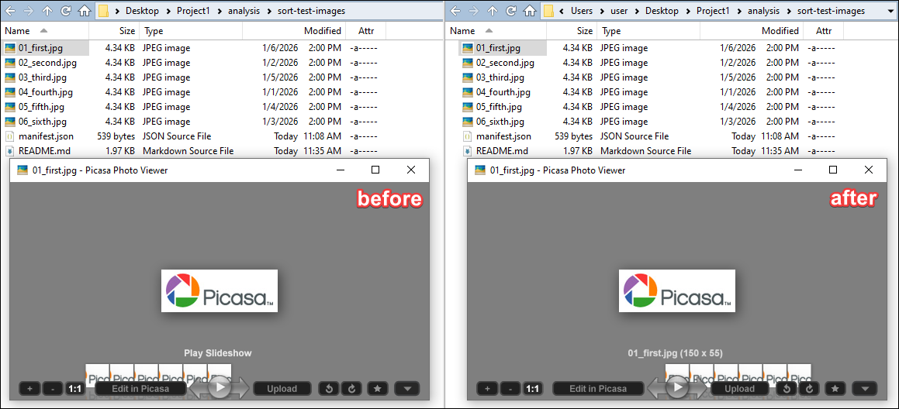

# Picasa Photo Viewer filename-order patch

A tiny patch that makes **Picasa Photo Viewer browse images by filename ascending when Windows Explorer's image order is unavailable**.

When an image is opened from a third-party file manager such as Directory Opus, Picasa can fall back to modification-date ordering for adjacent images. This project changes that fallback to filename ordering while retaining the comparisons that prioritize Explorer's displayed order.



The repository contains two small patch files and documentation. You supply the original Picasa executable and a patching tool.

## Supported executable

| Property | Required value |
| --- | --- |
| File | `PicasaPhotoViewer.exe` |
| Version | **3.1.70.73** |
| Architecture | **32-bit x86** |
| Size | **4,367,936 bytes** |
| Original CRC32 | `DF5903EF` |

Original SHA-256:

```text
c56683a64139c73148ca7e30972b567c6212e550a6273b9e48bd80b4bebf98e5
```

Other builds have not been investigated. The BPS patch checks the input checksum, so use the matching original executable.

## Apply the patch

1. Download the portable Windows version of [Floating IPS (Flips)](https://github.com/Sir-Walrus/Flips/releases/tag/v198).
2. Open Flips, click **Apply Patch**, and select [the BPS patch](patches/PicasaPhotoViewer-3.1.70.73-filename-order.bps).
3. Choose **All Files (*.*)** in the input dialog and select your original `PicasaPhotoViewer.exe`.
4. Save the output into a copy of your portable Picasa folder, keeping its adjacent `runtime` folder available.
5. Configure your file manager to launch the patched executable.

Close existing Picasa viewer sessions before testing. To test fallback ordering, also close Explorer windows displaying the same image folder: Picasa can discover a matching Explorer view even when another file manager launches it.

Keep the original executable for rollback. Editing the executable invalidates any previously valid embedded signature.

## Patch formats

| File | Size | Use |
| --- | --- | --- |
| [BPS](patches/PicasaPhotoViewer-3.1.70.73-filename-order.bps) | 43 bytes | Recommended; checks source, output, and patch CRC32 checksums. |
| [IPS](patches/PicasaPhotoViewer-3.1.70.73-filename-order.ips) | 25 bytes | Alternative for [Lunar IPS](https://fusoya.eludevisibility.org/lips/); verify the original hash yourself. |

Both files contain the same change. Choose one format. No Python or Ghidra is required to apply either patch.

## What changes

The patch changes seven bytes across two locations. It bypasses timestamp comparisons after equal Explorer-position checks and uses the existing filename/path comparison instead. Both the normal comparator and its inlined append optimization are changed so they use the same ordering.

| File offset | Original bytes | Patched bytes |
| --- | --- | --- |
| `0x00050519` | `8D 54 24 40` | `EB 15 90 90` |
| `0x00050BE7` | `8D 5F 08` | `EB 16 90` |

Filename comparison is bytewise and case-sensitive. Natural numeric ordering and locale-aware sorting are not added; for example, `10.jpg` sorts before `2.jpg`.

Expected patched SHA-256:

```text
3f2dc3d0bb35d6d1cf063ac70ad826ca66d9b072d5128811c9135f8d5c21eb79
```

See [manifest.json](patches/manifest.json) for patch hashes and compatibility information.

The patch was derived from Ghidra disassembly and decompiled code. It is specific to the executable identified above.
